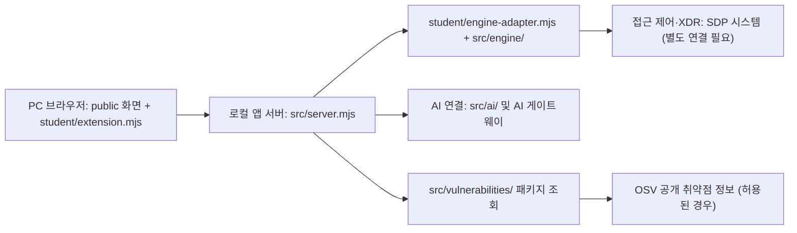

# 디야짱짱맨 학생용 실행 설명서

디야짱짱맨은 케셰브 시작 틀로 만든 보안 Agent다. 내 사용자·기기 상태, 업무 앱의 접속 판정과 보안 기록을 표시하고, 연결이 준비되면 AI 설명과 조치 상태를 보여 준다. 이 문서는 이 프로젝트의 개발용 실행을 설명한다. 앱이 켜졌다는 사실만으로 SDP나 AI 연결이 성공한 것은 아니다.

## 준비와 폴더

- 이 문서는 Windows PowerShell과 PC 브라우저를 기준으로 한다. 다른 운영체제의 실행은 확인하지 않았다.
- Node.js가 필요하다. 제공 실행 안내의 지원 범위는 22~24, 수업 기준 버전은 24.19.0이다. 이 PC에서 `node --version`으로 확인한 버전은 **24.22.1**이다. 이 버전으로 전체 연결이 검증됐다는 뜻은 아니다.
- `on-client/package.json`의 앱 버전은 **0.2.21**이며 외부 npm 의존성이 없다고 제공 README에 기재돼 있다. 이 작업에서 `on-client/package-lock.json`은 확인되지 않았다. 임의로 의존성을 설치하거나 낮추지 않는다.
- Git 저장소는 `C:\Users\User\Documents\ChatGPT\ALEPH 방어전\choi-bujang-secret-vault`, 앱 폴더는 그 안의 `on-client`다. 다른 PC에서는 본인의 프로젝트 위치를 사용한다.

```text
choi-bujang-secret-vault/          Git 프로젝트
  on-client/
    package.json                  실행 명령과 앱 버전
    student/extension.mjs         학생이 만든 표시 함수
    student/engine-adapter.mjs    제공 연결 어댑터
    public/                       제공 브라우저 화면
    src/server.mjs                로컬 앱 서버
    src/engine/                   SDP 연결 코드
    src/ai/                       AI 연결 코드
    src/vulnerabilities/          패키지 조회 코드
    tools/start-alekov.ps1        Windows 개발용 실행 도구
    docs/                         제공 안내와 이 문서
```

## 실행, 종료, 재실행

1. 파일 탐색기에서 위 프로젝트의 `on-client` 폴더를 열고, 주소 표시줄에 `powershell`을 입력해 새 창을 연다. 이미 열려 있는 앱과 기존 작업은 그대로 둔다.
2. 이 PC에서 작업 위치와 Node 버전을 확인한다.

   ```powershell
   Get-Location
   node --version
   ```

3. 앱 폴더에서 다음을 실행한다. 이 도구는 계정 연결을 위한 개인 설정을 준비할 수 있으며, 로그인과 승인은 사용자가 직접 한다.

   ```powershell
   powershell -NoProfile -ExecutionPolicy Bypass -File .\tools\start-alekov.ps1
   ```

4. 제공 실행 안내에 따르면 정상 시작 시 `케셰브가 켜졌습니다. 브라우저에서 http://127.0.0.1:5189/ 을 여세요.`와 서버 응답만 확인했다는 안내가 나온다. 브라우저에서 `http://127.0.0.1:5189/`를 열어 「보호 현황」을 확인한다. 사용자는 5191 포트에서 앱 화면이 열리는 것을 확인했다고 알려줬다.
5. 종료하려면 **이 실행을 시작한 PowerShell 창**에서 `Ctrl+C`를 누른다. 다시 실행하려면 같은 앱 폴더에서 3번 명령을 다시 실행한다. 다른 프로세스는 종료하지 않는다.

5189 포트를 다른 앱이 쓰면 실행 도구 명령 끝에 ` -Port 5190`을 붙이고 `http://127.0.0.1:5190/`을 연다. 그 포트도 사용 중이라면 사용하지 않는 다른 포트를 지정한다. 이번에는 사용자가 5191 화면 확인과 터미널 종료를 보고했다. `npm start`는 `package.json`의 기본 서버 명령이며, `npm run demo`는 예제 자료다. 예제는 실제 연결 확인이 아니다. `npm run check`는 학생 파일 문법만 확인한다.

## 구성과 데이터 흐름



브라우저는 로컬 서버에 요청한다. SDP 연결이 준비되면 서버는 본인 범위의 접속 판정·기록을 조회해 화면에 전달한다. AI 연결은 별도 계정 확인과 앱 승인을 사용한다. 사건 설명은 현재 사건과 근거 및 양쪽 계정의 승인된 대응이 필요하다. OSV 조회도 대상 프로젝트와 허용된 공개 패키지가 준비된 경우에만 이뤄진다. 이 그림은 코드상 경로이며 모든 외부 연결이 현재 작동한다는 의미가 아니다. 비밀자료실과 SDP의 실제 연결도 확인되지 않았다.

## 제공 코드와 학생 작성 부분

| 범위 | 역할과 경계 |
|---|---|
| `public/`, `src/server.mjs`, `src/engine/`, `src/ai/` | 제공 화면·서버·연결 처리. 학생 표시 함수가 네트워크 요청이나 인증을 대신하지 않는다. |
| `student/extension.mjs`: `renderIdentity`, `renderDecision` | 사용자·기기·세션과 업무 앱의 허용·거부 등 판정 표시. |
| `renderEvents`, `renderStatus` | 보안 기록·상세와 알림·도움정보 표시. |
| `renderAiConnection`, `renderExplanation` | AI 연결 점검 상태와 사건 근거에 연결된 설명 표시. |
| `renderAction` | 조치 준비·사람 확인·서버 접수·실제 효과를 구분해 표시. 실제 조치를 직접 실행하지 않는다. |
| `renderVulnerabilities` | 전달받은 패키지의 정확한 버전과 OSV 조회 결과·미조회·부분 실패를 구분해 표시. |

## 확인 결과와 미확인 범위

| 항목 | 확인 범위 |
|---|---|
| 19·20단계 학생 표시 | 문법 및 모의 입력 점검을 수행했다. 사용자가 두 단계의 공식 통과를 알려줬다. 모의 결과는 실제 서버 집행이나 실제 OSV 조회가 아니다. |
| AI 계정과 모델 목록 | 사용자가 연결과 목록 점검을 완료했다고 알려줬다. 이 문서 작성 중 직접 재확인하지 않았다. 목록 점검은 실제 사건 설명 성공이 아니다. |
| SDP 기록·비밀자료실 연결 | 사용자 화면에 연결된 보안 기록이 없었다. 실제 SDP 등록·기록 조회와 자료실 연결은 미확인이다. |
| 19단계 실제 조치 | 실제 원천 권한·집행·결과 재조회는 미확인이다. 시험 삼아 실제 조치를 요청하지 않는다. |
| 20단계 패키지 조회 | 사용자 화면에서 `PROJECT_NOT_CONFIGURED`를 확인했다고 알려줬다. 실제 OSV 조회와 설치 버전 대조는 미확인이다. 당시 학생 칸은 이전 구현 대기 문구였다. |
| 이번 실행 절차 | 경로·명령·버튼 이름은 파일을 읽어 대조했다. 사용자는 새 PowerShell에서 5189·5190 포트 사용 중 안내를 보고, 5191 화면이 열리고 터미널에서 종료했다고 알려줬다. 종료 후 재실행은 미확인이다. |

## 문제가 생겼을 때

| 상황 | 확인과 다음 순서 |
|---|---|
| Node.js 없음 또는 버전 오류 | `node --version`을 확인하고 제공 안내의 지원 버전을 설치한 뒤 새 PowerShell을 연다. |
| 5189 포트 사용 중 | 기존 프로그램은 유지하고 실행 도구에 `-Port 5190`을 붙인다. 브라우저에도 같은 포트를 쓴다. |
| `ENGINE_NOT_CONNECTED` 또는 보안 기록 연결 없음 | 현재 실행에 SDP 연결 설정이 있는지와 담당자의 준비 상태를 확인한다. 빈 기록이나 성공으로 단정하지 않는다. |
| AI 승인 대기 | 같은 계정으로 승인했는지 확인하고 앱의 상태 확인을 사용한다. 기한이 지났다면 제공 AI 연결 안내를 따른다. |
| `ON_AI_PROVISIONING_PENDING` | 앱 이용 권한 준비 상태를 담당자에게 확인한다. 승인되지 않은 성공으로 표시하지 않는다. |
| `PROJECT_NOT_CONFIGURED` | 조회할 프로젝트 설정이 없다는 뜻이다. 담당자의 준비를 기다린다. 취약점 없음이 아니다. |
| `NO_APPROVED_PACKAGES` / `not_checked` | 승인된 공개 조회 대상이 없어 조회하지 않은 상태다. 허용 목록을 임의로 바꾸지 않는다. |
| 학생 칸에 이전 구현 대기 문구 | 실행 중인 앱이 어느 폴더의 파일을 사용하는지 확인한다. 브라우저 새로고침으로 해결되지 않으면 설치본과 작업 폴더를 비교한다. 기존 설정을 지우지 않는다. |

자세한 오류별 안내는 [CONNECTION_TROUBLESHOOT.md](CONNECTION_TROUBLESHOOT.md), 실행 도구는 [STUDENT_LAUNCH_GUIDE.md](STUDENT_LAUNCH_GUIDE.md), AI 연결은 [AI_SETUP_GUIDE.md](AI_SETUP_GUIDE.md)를 참고한다. 키·토큰·비밀번호·개인 인증 파일은 문서나 Git에 적지 않는다.
